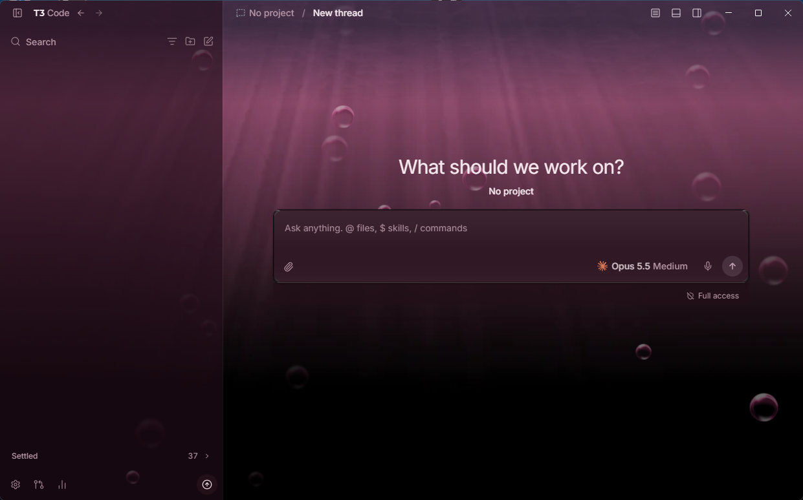

# Homebrew Channel theme for T3 Code

[](https://github.com/FrankieFms/homebrew-t3code/releases/latest)
[](https://github.com/FrankieFms/homebrew-t3code/releases)
[](https://github.com/FrankieFms/homebrew-t3code/stargazers)

A T3 Code theme inspired by the channel menu of The Homebrew Channel on the Nintendo Wii.
Bubbles rise behind the chat, the sidebar and chat box sit on dark HBC-style bars, and the
selected thread uses the steel-blue focus bar from the original menu.


[Watch the bubbles move](assets/previews/homebrew-default-video.mp4).

## Install

1. Download a theme from the list below.
2. In T3 Code, open **Settings** and go to **Appearance**.
3. Import a theme and pick the file you downloaded.

All themes are dark only, so set T3 Code to dark mode.

## Themes

Each color has its own recolored water, tinted bubbles and matching accent.

| | | |
|:-:|:-:|:-:|
| <br>**Homebrew Channel**<br><sub>The original</sub><br>[Download](https://github.com/FrankieFms/homebrew-t3code/releases/latest/download/homebrew-channel.json) | <br>**No Background**<br><sub>Navy gradient, no image</sub><br>[Download](https://github.com/FrankieFms/homebrew-t3code/releases/latest/download/homebrew-channel-no-bg.json) | <br>**Pink**<br>[Download](https://github.com/FrankieFms/homebrew-t3code/releases/latest/download/homebrew-channel-pink.json) |
| <br>**Red**<br>[Download](https://github.com/FrankieFms/homebrew-t3code/releases/latest/download/homebrew-channel-red.json) | <br>**Orange**<br>[Download](https://github.com/FrankieFms/homebrew-t3code/releases/latest/download/homebrew-channel-orange.json) | <br>**Gold**<br>[Download](https://github.com/FrankieFms/homebrew-t3code/releases/latest/download/homebrew-channel-gold.json) |
| <br>**Yellow**<br>[Download](https://github.com/FrankieFms/homebrew-t3code/releases/latest/download/homebrew-channel-yellow.json) | <br>**Green**<br>[Download](https://github.com/FrankieFms/homebrew-t3code/releases/latest/download/homebrew-channel-green.json) | <br>**Teal**<br>[Download](https://github.com/FrankieFms/homebrew-t3code/releases/latest/download/homebrew-channel-teal.json) |
| <br>**Indigo**<br>[Download](https://github.com/FrankieFms/homebrew-t3code/releases/latest/download/homebrew-channel-indigo.json) | <br>**Purple**<br>[Download](https://github.com/FrankieFms/homebrew-t3code/releases/latest/download/homebrew-channel-purple.json) | <br>**Magenta**<br>[Download](https://github.com/FrankieFms/homebrew-t3code/releases/latest/download/homebrew-channel-magenta.json) |
| <br>**Grey**<br>[Download](https://github.com/FrankieFms/homebrew-t3code/releases/latest/download/homebrew-channel-grey.json) |  |  |

<details>
<summary>Install from a terminal</summary>

Replace `homebrew-channel` with the id of the theme you want: `homebrew-channel`, `homebrew-channel-no-bg`, `homebrew-channel-pink`, `homebrew-channel-red`, `homebrew-channel-orange`, `homebrew-channel-gold`, `homebrew-channel-yellow`, `homebrew-channel-green`, `homebrew-channel-teal`, `homebrew-channel-indigo`, `homebrew-channel-purple`, `homebrew-channel-magenta`, `homebrew-channel-grey`.
Keep the file name, because T3 Code uses it as the theme id.

macOS:

```sh
curl -fsSLO https://github.com/FrankieFms/homebrew-t3code/releases/latest/download/homebrew-channel.json
t3 theme set ./homebrew-channel.json
```

Windows (PowerShell):

```powershell
Invoke-WebRequest https://github.com/FrankieFms/homebrew-t3code/releases/latest/download/homebrew-channel.json -OutFile homebrew-channel.json
t3 theme set .\homebrew-channel.json
```

If your terminal cannot find `t3`, use its full path: `~/.t3/bin/t3` on macOS,
`%USERPROFILE%\.t3\bin\t3.cmd` on Windows.

To install every theme at once from a clone of this repository, see
[docs/DEVELOPMENT.md](docs/DEVELOPMENT.md#install-every-theme).

</details>

## Updating

T3 Code does not update themes by itself. To get a newer version, download the
theme again and import it. See the [releases](https://github.com/FrankieFms/homebrew-t3code/releases)
for what changed.

## Uninstall

Pick another theme in **Settings** > **Appearance**, or run `t3 theme clear`.

## Development

Building the themes, adding a color, performance notes and releases are in
[docs/DEVELOPMENT.md](docs/DEVELOPMENT.md).

## Credits

The Homebrew Channel is by Team Twiizers. This theme is a fan tribute and is not
affiliated with Team Twiizers, Nintendo or T3 Code.
