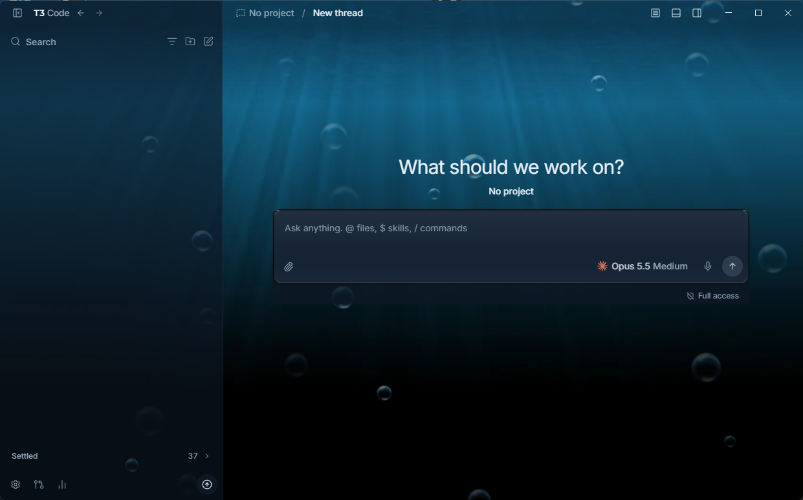
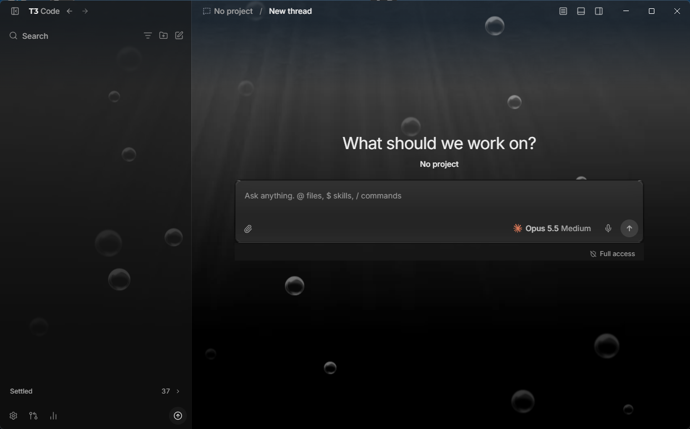

# Homebrew Channel theme for T3 Code

A T3 Code theme inspired by the channel menu of The Homebrew Channel on the Nintendo Wii.
Bubbles rise behind the chat, panels are frosted glass, and messages sit in rounded channel tiles.

## Themes

All themes are in the `themes/` folder. Run the install command from the repository folder.
All themes are dark only, so set T3 Code to dark mode.

### Homebrew Channel



The main theme: the Homebrew Channel underwater background, bubbles and Wii-blue accents. Dark only. [Watch the bubbles move](assets/previews/homebrew-default-video.mp4).

```sh
t3 theme set ./themes/homebrew-channel.json
```

### Pink


Light pink water, pink bubbles and accents.

```sh
t3 theme set ./themes/homebrew-channel-pink.json
```

### Red


Red water, red bubbles and accents.

```sh
t3 theme set ./themes/homebrew-channel-red.json
```

### Orange


Orange water, bubbles and accents.

```sh
t3 theme set ./themes/homebrew-channel-orange.json
```

### Gold


Gold water, bubbles and accents.

```sh
t3 theme set ./themes/homebrew-channel-gold.json
```

### Yellow


Lime-yellow water, bubbles and accents.

```sh
t3 theme set ./themes/homebrew-channel-yellow.json
```

### Green


Green water, bubbles and accents.

```sh
t3 theme set ./themes/homebrew-channel-green.json
```

### Teal


Teal water, bubbles and accents.

```sh
t3 theme set ./themes/homebrew-channel-teal.json
```

### Indigo


Indigo water, bubbles and accents.

```sh
t3 theme set ./themes/homebrew-channel-indigo.json
```

### Purple


Purple water, bubbles and accents.

```sh
t3 theme set ./themes/homebrew-channel-purple.json
```

### Magenta


Magenta water, bubbles and accents.

```sh
t3 theme set ./themes/homebrew-channel-magenta.json
```

### Grey



Charcoal water, grey bubbles and white accents.

```sh
t3 theme set ./themes/homebrew-channel-grey.json
```

### Other versions

- **No Background**: the main theme with no background image. Dark mode uses a navy gradient.

  ```sh
  t3 theme set ./themes/homebrew-channel-no-bg.json
  ```

- **Colors only**: a dark, deep navy look with Wii-blue accents and no CSS.

  ```sh
  t3 theme set ./themes/homebrew-channel-colors.json
  ```

## Requirements

- The `t3` CLI. T3 Code installs it at `~/.t3/bin/t3` (`t3.cmd` on Windows).

Check that your build supports themes:

```sh
t3 theme --help
```

If the command shows `set`, `clear` and `show`, your build supports themes.

## Install

1. Clone or download this repository.
2. Open a terminal in the repository folder.
3. Publish a theme and make it the active theme. For example, the main theme:

   ```sh
   t3 theme set ./themes/homebrew-channel.json
   ```

   T3 Code publishes the file under its file name as the theme id, here `homebrew-channel`.
   Connected T3 Code windows switch to it.

4. Check that the theme is active:

   ```sh
   t3 theme show
   ```

   The output should show `Environment theme: "homebrew-channel"`.

The published copy lives in `~/.t3/userdata/themes/`. After the first publish,
you can switch between published themes by id:

```sh
t3 theme set homebrew-channel-pink
```

### Install by copying the file

You can also copy a theme file into `~/.t3/userdata/themes/` yourself.
T3 Code watches that folder and lists the theme. Then pick it in T3 Code,
or run `t3 theme set <theme id>`.

## Customize

```
themes/              Ready-to-use theme files. Built by scripts/build-theme.py,
                     except homebrew-channel-colors.json, which is edited by hand.
src/
  hbc-bubbles.css    A pure-CSS version of the rising background bubbles.
  hbc-theme.css      The Homebrew Channel styling for T3 Code's layout.
scripts/
  build-theme.py     Holds the palettes and the list of themes. Merges them with
                     the CSS and backgrounds into themes/.
  make-backgrounds.py  Makes the recolored WebP backgrounds. Needs Pillow.
assets/
  source/            The original Homebrew Channel backgrounds.
  generated/         The compressed WebP backgrounds the themes embed.
  previews/          Screenshots of each theme for this README.
```

The dark palette of the main theme comes from `themes/homebrew-channel-colors.json`.
The pink and red palettes are tinted from it.

After editing a CSS file or a palette, rebuild the themes and apply one:

```sh
python scripts/build-theme.py
t3 theme set ./themes/homebrew-channel.json
```

To add a color variation, add a background entry in `scripts/make-backgrounds.py`
and a theme entry in `THEMES` in `scripts/build-theme.py`. Then run both scripts:

```sh
pip install pillow
python scripts/make-backgrounds.py
python scripts/build-theme.py
```

Each theme's CSS can be at most 50,000 characters. The build script stops if one is longer.

## Uninstall

Remove the theme from the environment:

```sh
t3 theme clear
```

Connected clients keep the theme they already have until you pick another
theme. To remove the published copies as well, delete the theme files from
`~/.t3/userdata/themes/`.

## Limits

- Color values must be hex (`#rgb` or `#rrggbb`).
- The `css` field holds at most 50,000 characters. Images must be embedded as `data:` URLs.
- CSS cannot reach the terminal text, the file tree or diff internals. Those use the color roles.
