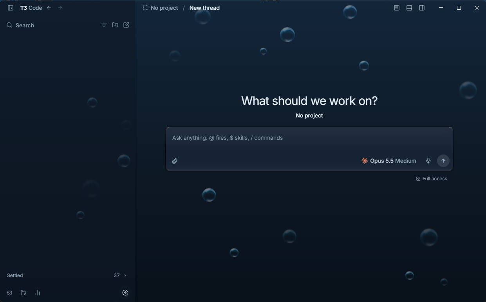
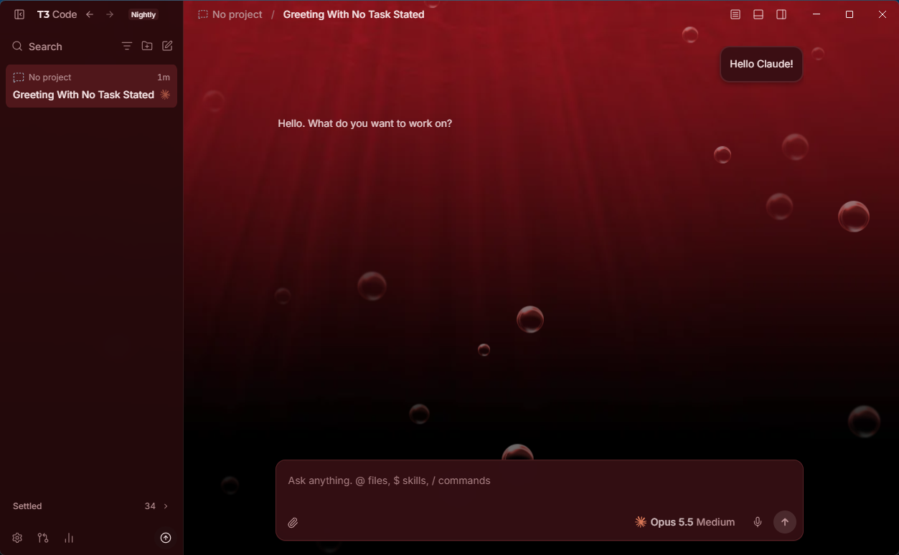
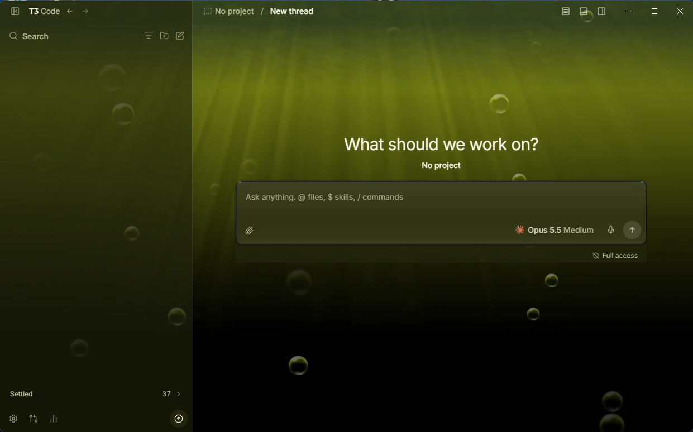
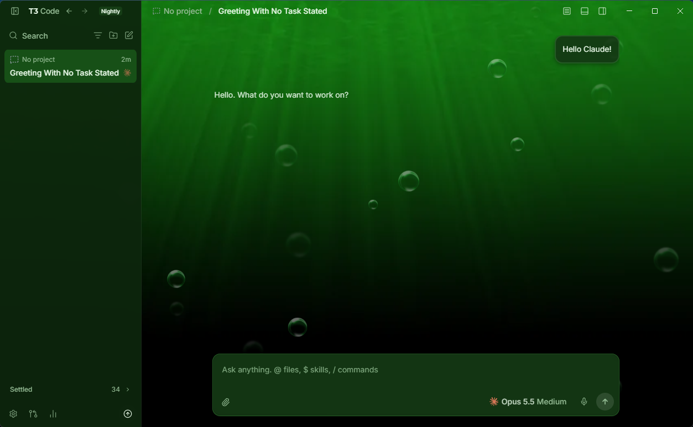
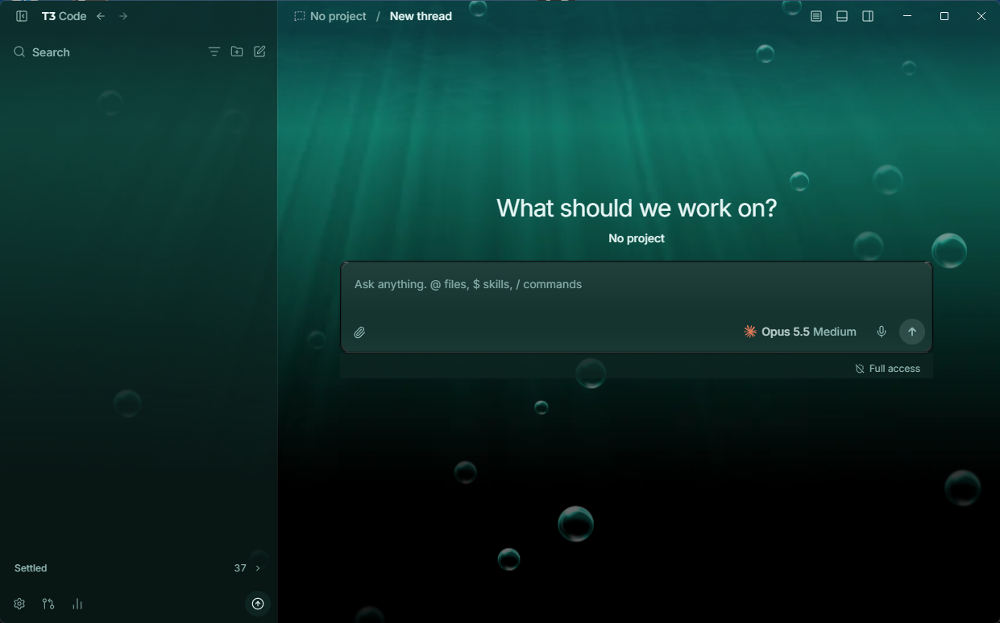
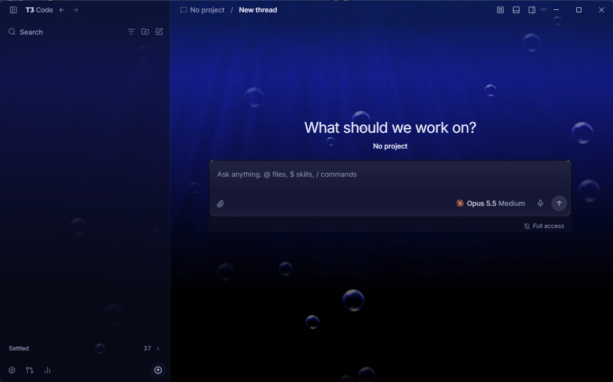
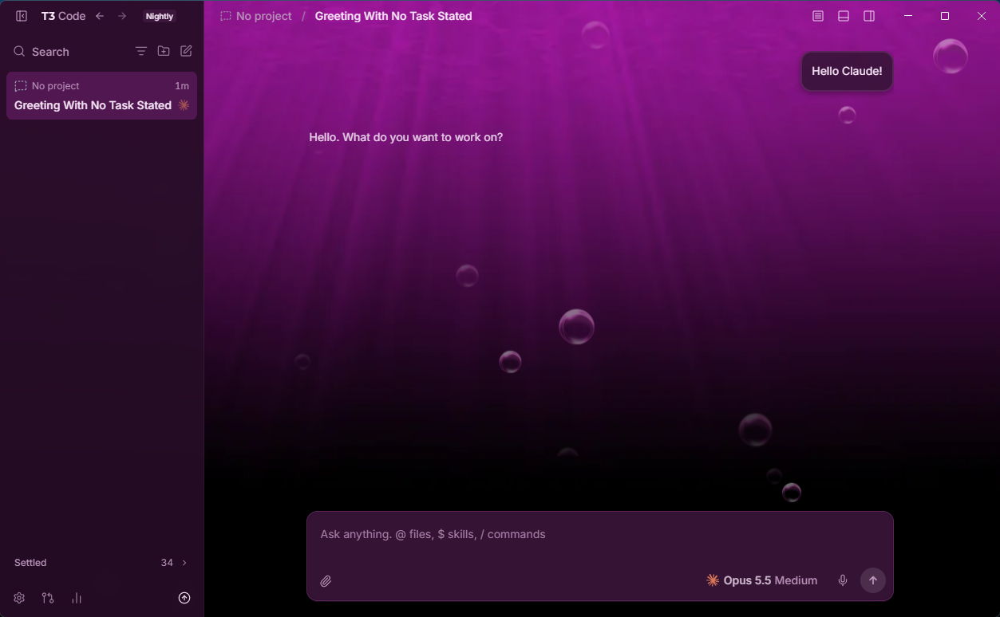

# Homebrew Channel theme for T3 Code

A T3 Code theme inspired by the channel menu of The Homebrew Channel on the Nintendo Wii.
Bubbles rise behind the chat, the sidebar and chat box sit on dark HBC-style bars, and the
selected thread uses the steel-blue focus bar from the original menu.


[Watch the bubbles move](assets/previews/homebrew-default-video.mp4).

## Quick start

1. Download [homebrew-channel.json](https://github.com/FrankieFms/homebrew-t3code/releases/latest/download/homebrew-channel.json).
2. In T3 Code, open **Settings** and go to **Appearance**.
3. Import a theme and pick the file you downloaded.

All themes are dark only, so set T3 Code to dark mode.
Every other theme installs the same way. Pick one from the [gallery](#gallery).

## Gallery

| | | |
|:-:|:-:|:-:|
| [](#homebrew-channel)<br>**[Homebrew Channel](#homebrew-channel)** | [](#no-background)<br>**[No Background](#no-background)** | [](#pink)<br>**[Pink](#pink)** |
| [](#red)<br>**[Red](#red)** | [](#orange)<br>**[Orange](#orange)** | [](#gold)<br>**[Gold](#gold)** |
| [](#yellow)<br>**[Yellow](#yellow)** | [](#green)<br>**[Green](#green)** | [](#teal)<br>**[Teal](#teal)** |
| [](#indigo)<br>**[Indigo](#indigo)** | [](#purple)<br>**[Purple](#purple)** | [](#magenta)<br>**[Magenta](#magenta)** |
| [](#grey)<br>**[Grey](#grey)** | | |

## Themes

Every theme is attached to the [latest release](https://github.com/FrankieFms/homebrew-t3code/releases/latest).
Download a theme, then import it in T3 Code under **Settings** > **Appearance**.
Each theme also has terminal commands, if you prefer the `t3` CLI.
Every color variation has its own recolored water, pre-tinted bubbles and matching accent.

### Homebrew Channel


The main theme: the Homebrew Channel underwater background, bubbles and Wii-blue accents.

[Download homebrew-channel.json](https://github.com/FrankieFms/homebrew-t3code/releases/latest/download/homebrew-channel.json), then import it in **Settings** > **Appearance**.

<details>
<summary>Install from a terminal</summary>

macOS:

```sh
curl -fsSLO https://github.com/FrankieFms/homebrew-t3code/releases/latest/download/homebrew-channel.json
t3 theme set ./homebrew-channel.json
```

Windows (PowerShell):

```powershell
Invoke-WebRequest https://github.com/FrankieFms/homebrew-t3code/releases/latest/download/homebrew-channel.json -OutFile homebrew-channel.json
t3 theme set .\homebrew-channel.json
```

From a clone of this repository:

```sh
t3 theme set ./themes/homebrew-channel.json
```

</details>

### No Background


The main theme with a plain navy gradient in place of the underwater image. The bubbles stay.

[Download homebrew-channel-no-bg.json](https://github.com/FrankieFms/homebrew-t3code/releases/latest/download/homebrew-channel-no-bg.json), then import it in **Settings** > **Appearance**.

<details>
<summary>Install from a terminal</summary>

macOS:

```sh
curl -fsSLO https://github.com/FrankieFms/homebrew-t3code/releases/latest/download/homebrew-channel-no-bg.json
t3 theme set ./homebrew-channel-no-bg.json
```

Windows (PowerShell):

```powershell
Invoke-WebRequest https://github.com/FrankieFms/homebrew-t3code/releases/latest/download/homebrew-channel-no-bg.json -OutFile homebrew-channel-no-bg.json
t3 theme set .\homebrew-channel-no-bg.json
```

From a clone of this repository:

```sh
t3 theme set ./themes/homebrew-channel-no-bg.json
```

</details>

### Pink


Light pink water, pink bubbles and accents.

[Download homebrew-channel-pink.json](https://github.com/FrankieFms/homebrew-t3code/releases/latest/download/homebrew-channel-pink.json), then import it in **Settings** > **Appearance**.

<details>
<summary>Install from a terminal</summary>

macOS:

```sh
curl -fsSLO https://github.com/FrankieFms/homebrew-t3code/releases/latest/download/homebrew-channel-pink.json
t3 theme set ./homebrew-channel-pink.json
```

Windows (PowerShell):

```powershell
Invoke-WebRequest https://github.com/FrankieFms/homebrew-t3code/releases/latest/download/homebrew-channel-pink.json -OutFile homebrew-channel-pink.json
t3 theme set .\homebrew-channel-pink.json
```

From a clone of this repository:

```sh
t3 theme set ./themes/homebrew-channel-pink.json
```

</details>

### Red


Red water, red bubbles and accents.

[Download homebrew-channel-red.json](https://github.com/FrankieFms/homebrew-t3code/releases/latest/download/homebrew-channel-red.json), then import it in **Settings** > **Appearance**.

<details>
<summary>Install from a terminal</summary>

macOS:

```sh
curl -fsSLO https://github.com/FrankieFms/homebrew-t3code/releases/latest/download/homebrew-channel-red.json
t3 theme set ./homebrew-channel-red.json
```

Windows (PowerShell):

```powershell
Invoke-WebRequest https://github.com/FrankieFms/homebrew-t3code/releases/latest/download/homebrew-channel-red.json -OutFile homebrew-channel-red.json
t3 theme set .\homebrew-channel-red.json
```

From a clone of this repository:

```sh
t3 theme set ./themes/homebrew-channel-red.json
```

</details>

### Orange


Orange water, bubbles and accents.

[Download homebrew-channel-orange.json](https://github.com/FrankieFms/homebrew-t3code/releases/latest/download/homebrew-channel-orange.json), then import it in **Settings** > **Appearance**.

<details>
<summary>Install from a terminal</summary>

macOS:

```sh
curl -fsSLO https://github.com/FrankieFms/homebrew-t3code/releases/latest/download/homebrew-channel-orange.json
t3 theme set ./homebrew-channel-orange.json
```

Windows (PowerShell):

```powershell
Invoke-WebRequest https://github.com/FrankieFms/homebrew-t3code/releases/latest/download/homebrew-channel-orange.json -OutFile homebrew-channel-orange.json
t3 theme set .\homebrew-channel-orange.json
```

From a clone of this repository:

```sh
t3 theme set ./themes/homebrew-channel-orange.json
```

</details>

### Gold


Gold water, bubbles and accents.

[Download homebrew-channel-gold.json](https://github.com/FrankieFms/homebrew-t3code/releases/latest/download/homebrew-channel-gold.json), then import it in **Settings** > **Appearance**.

<details>
<summary>Install from a terminal</summary>

macOS:

```sh
curl -fsSLO https://github.com/FrankieFms/homebrew-t3code/releases/latest/download/homebrew-channel-gold.json
t3 theme set ./homebrew-channel-gold.json
```

Windows (PowerShell):

```powershell
Invoke-WebRequest https://github.com/FrankieFms/homebrew-t3code/releases/latest/download/homebrew-channel-gold.json -OutFile homebrew-channel-gold.json
t3 theme set .\homebrew-channel-gold.json
```

From a clone of this repository:

```sh
t3 theme set ./themes/homebrew-channel-gold.json
```

</details>

### Yellow


Lime-yellow water, bubbles and accents.

[Download homebrew-channel-yellow.json](https://github.com/FrankieFms/homebrew-t3code/releases/latest/download/homebrew-channel-yellow.json), then import it in **Settings** > **Appearance**.

<details>
<summary>Install from a terminal</summary>

macOS:

```sh
curl -fsSLO https://github.com/FrankieFms/homebrew-t3code/releases/latest/download/homebrew-channel-yellow.json
t3 theme set ./homebrew-channel-yellow.json
```

Windows (PowerShell):

```powershell
Invoke-WebRequest https://github.com/FrankieFms/homebrew-t3code/releases/latest/download/homebrew-channel-yellow.json -OutFile homebrew-channel-yellow.json
t3 theme set .\homebrew-channel-yellow.json
```

From a clone of this repository:

```sh
t3 theme set ./themes/homebrew-channel-yellow.json
```

</details>

### Green


Green water, bubbles and accents.

[Download homebrew-channel-green.json](https://github.com/FrankieFms/homebrew-t3code/releases/latest/download/homebrew-channel-green.json), then import it in **Settings** > **Appearance**.

<details>
<summary>Install from a terminal</summary>

macOS:

```sh
curl -fsSLO https://github.com/FrankieFms/homebrew-t3code/releases/latest/download/homebrew-channel-green.json
t3 theme set ./homebrew-channel-green.json
```

Windows (PowerShell):

```powershell
Invoke-WebRequest https://github.com/FrankieFms/homebrew-t3code/releases/latest/download/homebrew-channel-green.json -OutFile homebrew-channel-green.json
t3 theme set .\homebrew-channel-green.json
```

From a clone of this repository:

```sh
t3 theme set ./themes/homebrew-channel-green.json
```

</details>

### Teal


Teal water, bubbles and accents.

[Download homebrew-channel-teal.json](https://github.com/FrankieFms/homebrew-t3code/releases/latest/download/homebrew-channel-teal.json), then import it in **Settings** > **Appearance**.

<details>
<summary>Install from a terminal</summary>

macOS:

```sh
curl -fsSLO https://github.com/FrankieFms/homebrew-t3code/releases/latest/download/homebrew-channel-teal.json
t3 theme set ./homebrew-channel-teal.json
```

Windows (PowerShell):

```powershell
Invoke-WebRequest https://github.com/FrankieFms/homebrew-t3code/releases/latest/download/homebrew-channel-teal.json -OutFile homebrew-channel-teal.json
t3 theme set .\homebrew-channel-teal.json
```

From a clone of this repository:

```sh
t3 theme set ./themes/homebrew-channel-teal.json
```

</details>

### Indigo


Indigo water, bubbles and accents.

[Download homebrew-channel-indigo.json](https://github.com/FrankieFms/homebrew-t3code/releases/latest/download/homebrew-channel-indigo.json), then import it in **Settings** > **Appearance**.

<details>
<summary>Install from a terminal</summary>

macOS:

```sh
curl -fsSLO https://github.com/FrankieFms/homebrew-t3code/releases/latest/download/homebrew-channel-indigo.json
t3 theme set ./homebrew-channel-indigo.json
```

Windows (PowerShell):

```powershell
Invoke-WebRequest https://github.com/FrankieFms/homebrew-t3code/releases/latest/download/homebrew-channel-indigo.json -OutFile homebrew-channel-indigo.json
t3 theme set .\homebrew-channel-indigo.json
```

From a clone of this repository:

```sh
t3 theme set ./themes/homebrew-channel-indigo.json
```

</details>

### Purple


Purple water, bubbles and accents.

[Download homebrew-channel-purple.json](https://github.com/FrankieFms/homebrew-t3code/releases/latest/download/homebrew-channel-purple.json), then import it in **Settings** > **Appearance**.

<details>
<summary>Install from a terminal</summary>

macOS:

```sh
curl -fsSLO https://github.com/FrankieFms/homebrew-t3code/releases/latest/download/homebrew-channel-purple.json
t3 theme set ./homebrew-channel-purple.json
```

Windows (PowerShell):

```powershell
Invoke-WebRequest https://github.com/FrankieFms/homebrew-t3code/releases/latest/download/homebrew-channel-purple.json -OutFile homebrew-channel-purple.json
t3 theme set .\homebrew-channel-purple.json
```

From a clone of this repository:

```sh
t3 theme set ./themes/homebrew-channel-purple.json
```

</details>

### Magenta


Magenta water, bubbles and accents.

[Download homebrew-channel-magenta.json](https://github.com/FrankieFms/homebrew-t3code/releases/latest/download/homebrew-channel-magenta.json), then import it in **Settings** > **Appearance**.

<details>
<summary>Install from a terminal</summary>

macOS:

```sh
curl -fsSLO https://github.com/FrankieFms/homebrew-t3code/releases/latest/download/homebrew-channel-magenta.json
t3 theme set ./homebrew-channel-magenta.json
```

Windows (PowerShell):

```powershell
Invoke-WebRequest https://github.com/FrankieFms/homebrew-t3code/releases/latest/download/homebrew-channel-magenta.json -OutFile homebrew-channel-magenta.json
t3 theme set .\homebrew-channel-magenta.json
```

From a clone of this repository:

```sh
t3 theme set ./themes/homebrew-channel-magenta.json
```

</details>

### Grey


Charcoal water, grey bubbles and white accents.

[Download homebrew-channel-grey.json](https://github.com/FrankieFms/homebrew-t3code/releases/latest/download/homebrew-channel-grey.json), then import it in **Settings** > **Appearance**.

<details>
<summary>Install from a terminal</summary>

macOS:

```sh
curl -fsSLO https://github.com/FrankieFms/homebrew-t3code/releases/latest/download/homebrew-channel-grey.json
t3 theme set ./homebrew-channel-grey.json
```

Windows (PowerShell):

```powershell
Invoke-WebRequest https://github.com/FrankieFms/homebrew-t3code/releases/latest/download/homebrew-channel-grey.json -OutFile homebrew-channel-grey.json
t3 theme set .\homebrew-channel-grey.json
```

From a clone of this repository:

```sh
t3 theme set ./themes/homebrew-channel-grey.json
```

</details>

## Updating

T3 Code does not update themes by itself. To get the newest version of a theme,
download it again and import it in **Settings** > **Appearance**, or run its
terminal commands again. The download links always point to the latest release.

See the [releases page](https://github.com/FrankieFms/homebrew-t3code/releases)
for what changed in each version.

## Requirements

- T3 Code stable with theme support.
- For terminal installs only: the `t3` CLI. T3 Code installs it at `~/.t3/bin/t3` on macOS and
  `%USERPROFILE%\.t3\bin\t3.cmd` on Windows. If your terminal cannot find `t3`,
  type that full path in place of `t3`.

Check that your build supports themes:

```sh
t3 theme --help
```

If the command shows `set`, `clear` and `show`, your build supports themes.

## Install

The simplest way is from the app:

1. Download a theme file from the [latest release](https://github.com/FrankieFms/homebrew-t3code/releases/latest).
2. In T3 Code, open **Settings** and go to **Appearance**.
3. Import a theme and pick the file.

### Install from a terminal

1. Clone or download this repository.
2. Open a terminal in the repository folder.
3. Publish a theme and make it the active theme. For example, the main theme:

   ```sh
   t3 theme set ./themes/homebrew-channel.json
   ```

   T3 Code publishes the file under its file name as the theme id, here `homebrew-channel`.
   Connected T3 Code windows switch to it.

4. Check that the theme is active:

   ```sh
   t3 theme show
   ```

   The output should show `Environment theme: "homebrew-channel"`.

The published copy lives in `~/.t3/userdata/themes/` on macOS and
`%USERPROFILE%\.t3\userdata\themes\` on Windows. After the first publish,
you can switch between published themes by id:

```sh
t3 theme set homebrew-channel-pink
```

#### Install every theme at once

macOS:

```sh
for f in themes/*.json; do
  case "$f" in *-colors.json) continue ;; esac
  t3 theme set "$f"
done
t3 theme set homebrew-channel
```

Windows PowerShell:

```powershell
Get-ChildItem themes\*.json -Exclude *-colors.json | ForEach-Object { t3 theme set $_.FullName }
t3 theme set homebrew-channel
```

#### Install by copying the file

You can also copy a theme file into that `themes` folder yourself.
T3 Code watches that folder and lists the theme. Then pick it in T3 Code,
or run `t3 theme set <theme id>`.

## Performance

The bubbles move with GPU-composited `translate` animations, and the theme uses no
`backdrop-filter` blur. On a typical desktop, T3 Code's power use stays low to moderate
while idle. Scrolling and moving the mouse raise it for a moment, as in any app.

The original bubble animation is closer to the Homebrew Channel but repaints the whole
window every frame. To switch back to it, see the comment at the top of
`src/hbc-bubbles-fast.css` and `CSS_FILES` in `scripts/build-theme.py`.

## Customize

```
themes/                  Ready-to-use theme files. Built by scripts/build-theme.py,
                         except homebrew-channel-colors.json: the base palette the
                         build reads, edited by hand. It is not a theme to install.
src/
  hbc-bubbles-fast.css   The rising background bubbles, GPU-friendly. Used by default.
  hbc-bubbles.css        The original bubble animation, kept for switching back.
  hbc-theme.css          The Homebrew Channel styling for T3 Code's layout.
scripts/
  build-theme.py         Holds the palettes and the list of themes. Merges them with
                         the CSS, backgrounds and bubbles into themes/.
  make-backgrounds.py    Makes the recolored WebP backgrounds and tinted bubbles.
                         Needs Pillow.
assets/
  source/                The original Homebrew Channel background and bubble art.
  generated/             The WebP backgrounds and tinted bubbles the themes embed.
  previews/              Screenshots of each theme for this README.
```

The dark palette of the main theme comes from `themes/homebrew-channel-colors.json`.
Every color variation is tinted from it.

After editing a CSS file or a palette, rebuild the themes and apply one:

```sh
python scripts/build-theme.py
t3 theme set ./themes/homebrew-channel.json
```

To add a color variation:

1. Add a background entry to `VARIATIONS` and a bubble entry to `BUBBLE_TINTS`
   in `scripts/make-backgrounds.py`.
2. Add a palette and a `variation(...)` entry to `THEMES` in `scripts/build-theme.py`.
3. Run both scripts:

   ```sh
   pip install pillow
   python scripts/make-backgrounds.py
   python scripts/build-theme.py
   ```

The build script minifies the CSS inside each theme file. The files in `src/` keep their comments.

### Release a new version

Rebuild the themes, commit them to `main`, then push a version tag:

```sh
git tag v1.0.0
git push origin v1.0.0
```

`.github/workflows/release.yml` then creates a release with every theme file attached.
The install links in this README always point to the latest release.

## Uninstall

Remove the theme from the environment:

```sh
t3 theme clear
```

Connected clients keep the theme they already have until you pick another
theme. To remove the published copies as well, delete the theme files from
that `themes` folder.

## Limits

- Color values must be hex (`#rgb` or `#rrggbb`).
- The `css` field holds at most 50,000 characters. The build script stops if a theme is longer.
- CSS `url()` accepts only `data:` URLs, so the backgrounds and bubbles are embedded.
- CSS cannot reach the terminal text, the file tree or diff internals. Those use the color roles.

## Credits

The Homebrew Channel is by Team Twiizers. This theme is a fan tribute and is not
affiliated with Team Twiizers, Nintendo or T3 Code.
